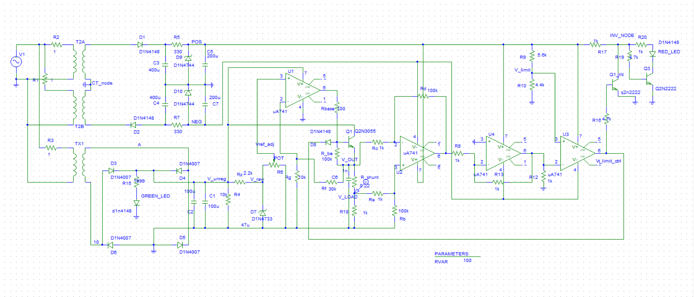

# analog-dc-voltage-regulator

**An adjustable analog DC voltage regulator designed and simulated using operational amplifiers and discrete electronic components in PSpice 9.1.**

## Overview

This project focuses on the design and simulation of an adjustable DC voltage regulator intended for laboratory applications.

The primary objective is to develop a regulated DC power supply capable of providing an adjustable output voltage using an operational amplifier-based feedback control system.

The circuit uses an operational amplifier as an error amplifier to compare the reference voltage with the feedback voltage and control a series pass transistor accordingly. This feedback mechanism helps maintain a stable output voltage under varying conditions.

The project emphasizes the practical application of analog electronics, operational amplifiers, voltage references, rectification, filtering, and feedback-based voltage regulation.

## Specifications / Methodology

### Design Specifications

| Parameter | Design Target |
|---|---|
| AC Input Supply | 220 V, 50 Hz |
| Transformer Secondary | 18 V RMS |
| Rectified DC Voltage | Approximately 23–25 V |
| Adjustable Output Voltage | Approximately 0–15 V DC |
| Initial Current Target | 0.5–1 A |
| Simulation Software | PSpice 9.1 |

### Major Components and Concepts

- **Operational Amplifier (μA741):** Used as the error amplifier in the feedback control system.
- **Zener Diode (5.1 V):** Provides a stable reference voltage.
- **Bridge Rectifier (1N4007):** Converts AC into pulsating DC.
- **Filter Capacitor (2200 μF):** Reduces rectified voltage ripple.
- **Series Pass Transistor:** Controls the output voltage by regulating the current supplied to the load.
- **Feedback Network:** Provides output voltage feedback to the operational amplifier for regulation.

### Design Approach

1. AC voltage transformation using an 18 V RMS secondary.
2. Full-wave rectification using a bridge rectifier.
3. DC filtering using a capacitor.
4. Generation of a reference voltage using a Zener diode.
5. Error amplification using an operational amplifier.
6. Output regulation through a series pass transistor.
7. Feedback-based voltage control and simulation in PSpice 9.1.

## Results

The complete circuit schematic was developed and simulated using PSpice 9.1.

The design targets an adjustable DC output voltage of approximately 0–15 V, with an initial load-current design target of 0.5–1 A.

### Final Circuit Schematic

*Note: Detailed simulation waveforms and measured output characteristics are available in the project report.*

## Files

| File | Description |
|---|---|
| `Final_circuit.png` | Final circuit schematic image |
| `Project_Final.sch` | PSpice circuit schematic file |
| `Group_04_EEE208_project_report.pdf` | Complete project report |
| `Group04_EEE208_Project_presentation.pptx` | Project presentation |
| `README.md` | Project documentation |

## Team

**Group 04**

- [Member 1 – ]
- [Member 2 – Name]
- [Member 3 – Name]
- [Member 4 – Name]

*Team member profiles can be added with their permission.*

## Course / Context

- **Course:** EEE 208
- **Department:** Electrical and Electronic Engineering (EEE)
- **University:** Bangladesh University of Engineering and Technology (BUET)
- **Academic Level:** Level 2, Term II
- **Group:** 04
- **Simulation Software:** PSpice 9.1

---

*This project was completed as part of the undergraduate Electrical and Electronic Engineering curriculum at BUET.*
